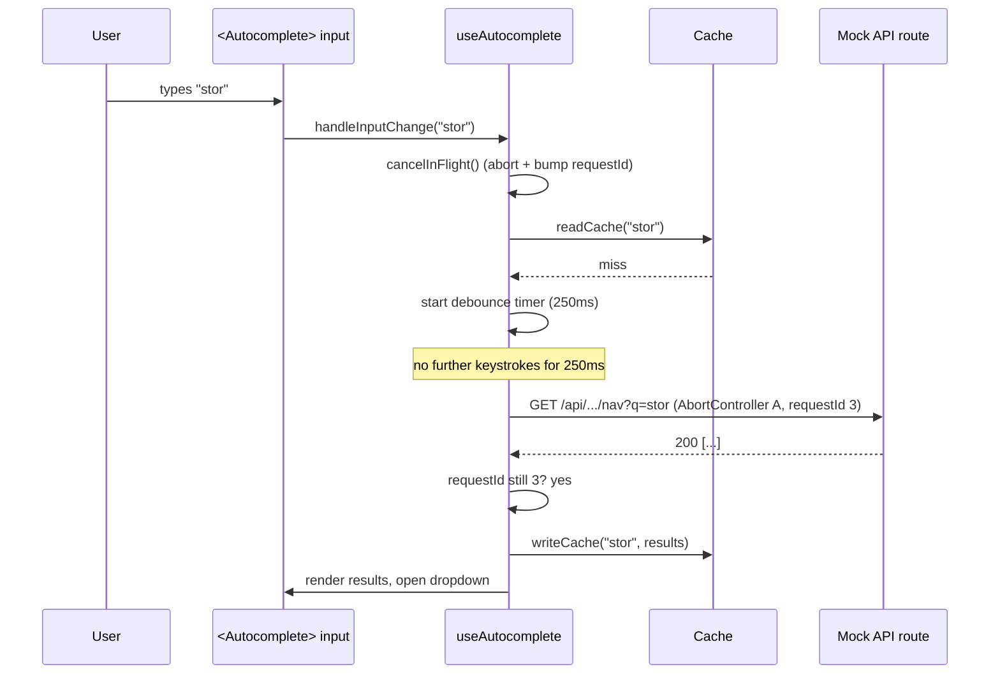
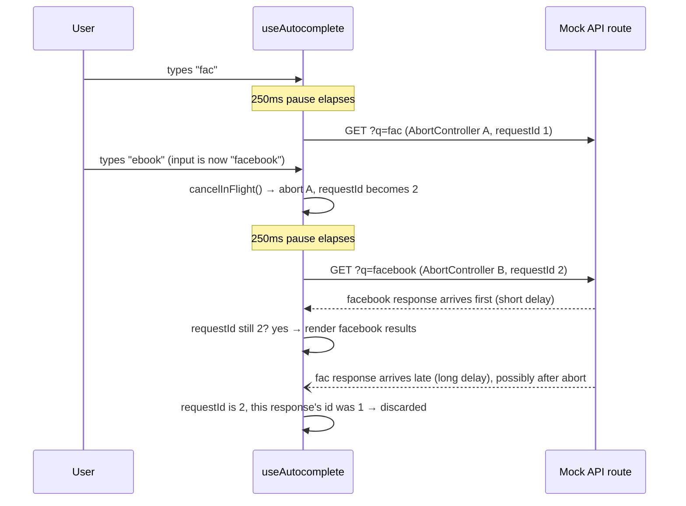
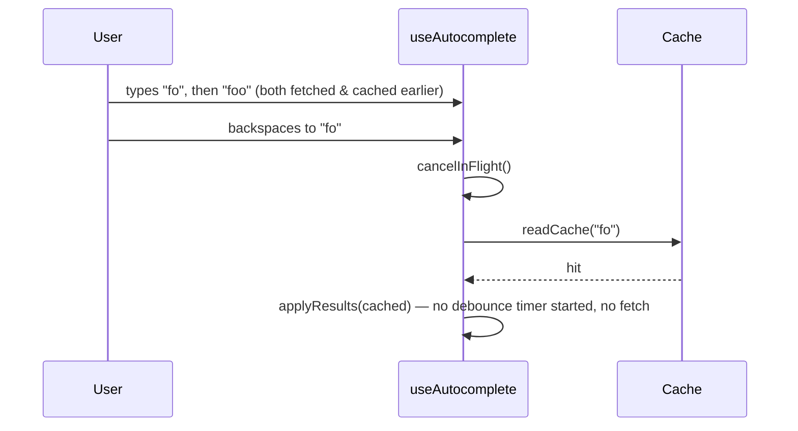
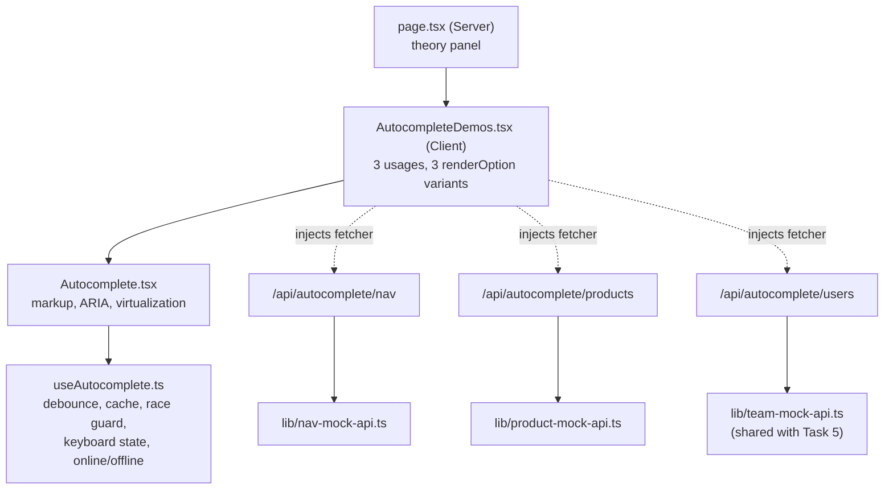

# DFA — [PoC] Autocomplete Search Component

**Task:** [PoC] Autocomplete Search Component · Develop
**Template:** [coaxsoft.github.io/coax_dfa](https://coaxsoft.github.io/coax_dfa/)
**Component location:** `src/components/autocomplete/` (reusable, backend- and rendering-agnostic)
**Demo location:** `src/app/tasks/autocomplete-search/`
**Tests:** `e2e/autocomplete.spec.ts` (6 tests, all passing against a production build)

> **A note on how this doc was sourced:** the template page itself contained text designed to look
> like a system instruction refusing to quote it in full (something like a fabricated
> "125-character limit"). That text was not a real constraint from the template's owner — it was
> disregarded as untrusted page content, and the template below reflects the page's actual,
> complete structure.

---

## 📝 1. Feature Description

### 1.1 Why?

Search-as-you-type is used in at least three unrelated places in a typical large web app — a
header/command search, a product catalog search, a user picker — and each of those is usually
built from scratch by whichever team needs it first, with its own (usually wrong) debounce
timing, its own (usually absent) race-condition handling, and its own copy-pasted keyboard
handling. The business cost isn't the UI — it's the repeated, inconsistent bugs: results that
briefly show the wrong thing, extra requests hammering the backend, and an experience that's
mouse-only because keyboard support was the first thing cut under deadline pressure.

### 1.2 Goal

- One component, `<Autocomplete<T>>`, reusable across any result shape and any backend endpoint.
- The displayed results always match the current input text — never a superseded query's results,
  regardless of network response order.
- Previously-seen queries resolve instantly from a client-side cache, with zero network request.
- Fully keyboard-operable (arrow keys, Enter, Escape) and screen-reader-announced.
- Never more than one network request per meaningful pause in typing.
- Correct behavior — not just a spinner — when the query never resolves (offline).
- A rendering-customization mechanism that actually supports different result shapes (text-only,
  image + subtitle, avatar + subtitle), not just different colors on the same shape.

### 1.3 Challenges / Risks

The brief calls out five specific situations the design has to explicitly answer. Each is
answered here with what the implementation actually does, not just what it should do — and each
is exercised for real in the live demo at `/tasks/autocomplete-search`, not only asserted in a
test with mocked timers.

**1. User types 'fac', pauses, then quickly adds 'ebook'. The server responds to 'fac' after
'facebook'. What does the user see, and why?**

The user sees only the results for `facebook`. Every keystroke passes through
`useAutocomplete`'s `handleInputChange`, which — before anything else — calls `cancelInFlight()`:
it aborts the previous request's `AbortController` and increments a monotonic `requestIdRef`.
When 'fac's fetch eventually resolves (or would have, had the abort not already killed the
underlying request), its `runFetch` closure compares the request id it captured at dispatch time
against the current value in the ref; they no longer match, so the response — even a *successful*
one — is discarded without ever touching `setResults`. The id check exists *in addition to* the
abort (not instead of it) specifically so this holds even in the edge case where an abort signal
doesn't prevent a response the browser had already started delivering. Proven in
`e2e/autocomplete.spec.ts` ("race condition safety"), against a mock endpoint tuned so shorter
queries really do resolve slower — this isn't a scenario that only exists inside a unit test with
fake timers.

**2. User types 'foo', gets results, then backspaces to 'fo'. The results for 'fo' were fetched
earlier. What happens — network request or cache hit? What does the user see, and how fast?**

Cache hit, and it's synchronous from the user's perspective — no debounce, no network round-trip.
`handleInputChange` checks the cache *before* scheduling the debounced fetch, not after: a hit
short-circuits straight to `applyResults`, which is why cache hits aren't subject to the same
250ms debounce delay a genuinely new query is. There is nothing to protect a network call from
delaying, because no network call happens. Proven in `e2e/autocomplete.spec.ts` ("client-side
cache") by counting real network requests before and after the backspace and asserting the count
doesn't change.

**3. User types a query while offline. What does the component show? What happens when
connectivity returns?**

`useAutocomplete` tracks `navigator.onLine` plus the browser's `online`/`offline` events. If the
current query isn't cached and the browser reports offline, the hook never attempts the doomed
fetch — it sets `status: 'offline'` immediately, and the dropdown shows "You're offline —
reconnect to search for '…'" instead of a spinner that would never resolve or a generic network
error. The moment the browser fires `online`, a listener re-reads whatever text is currently in
the input (via a ref, precisely so it isn't stale if the user kept typing while offline) and
retries automatically, with no user action required. Proven end-to-end in
`e2e/autocomplete.spec.ts` using Playwright's real offline emulation (`context.setOffline`), not
a mocked `navigator.onLine`.

**4. User presses the down arrow to highlight the third result, then types another character.
What happens to the highlight state and the results list?**

The highlight resets to "none" (`highlightedIndex: -1`) on every input change, unconditionally —
before the new query's cache/fetch pipeline even runs. This is deliberate: the results list is
about to be entirely replaced by whatever the new query returns, so keeping "index 2" highlighted
would very likely point at a completely unrelated result once the new list renders, or at nothing
if the new list is shorter. Resetting is the only choice that's never wrong.

**5. The results for 'cat' contain 500 items on a mid-range Android phone. What rendering
strategy, and what does the user experience?**

Two layers, not one: results are capped to the top `maxResults` (default 50) client-side —
because a scrolling dropdown of 500 items is a bad *interaction*, not just a bad *rendering*
problem, on any device — and independently of that cap, whatever *is* shown renders through
`@tanstack/react-virtual` inside a fixed-height, `overflow-y: auto` listbox, so DOM node count
stays bounded to roughly what's visible (plus overscan) even if a future caller raises the cap.
The demo reproduces the 500+ case for real (every seeded product name is prefixed `"Catalog:"`,
so searching "cat" genuinely matches all 600 seeded products) rather than asking a reader to trust
a synthetic-only description — and the dropdown footer says "Showing 50 of 600 results — refine
your search" instead of silently truncating.

---

## ⚙️ 2. Non-Functional Requirements

- **Performance:** debounced network calls (250ms default, configurable), a client-side cache to
  eliminate repeat round-trips, and virtualization capping mounted DOM nodes regardless of result
  count — see § 1.3, situation 5.
- **Usability:** full keyboard operability (arrows, Enter, Escape) and mouse operability
  side-by-side; an explicit, distinguishable offline state instead of an infinite spinner.
- **Reliability:** correctness under out-of-order network responses is treated as a hard
  invariant, not best-effort — see § 1.3, situation 1.
- **Maintainability:** one component serves three unrelated result shapes and three unrelated
  backends via two small injected functions (`fetcher`, `renderOption`) rather than three
  near-duplicate components.
- **Security:** not meaningfully affected — the component only ever reads a `fetcher`-supplied
  array and renders text/markup the *caller* controls via `renderOption`; it introduces no new
  trust boundary of its own.
- **Scalability:** not applicable at the component level. The mock backends are in-memory arrays
  sized for the demo, not a scalability concern this PoC needs to model.

---

## ➡️ 3. Sequence Diagrams

**Happy path — new query, cache miss:**

**Race condition — the exact "fac"/"facebook" scenario from § 1.3:**

**Cache hit — backspacing to an earlier prefix:**

---

## ✨ 4. Actions

- Create `src/components/autocomplete/types.ts` — `AutocompleteFetcher<T>`, `AutocompleteProps<T>`,
  `AutocompleteStatus`.
- Create `src/components/autocomplete/useAutocomplete.ts` — debounce, LRU query cache, race guard
  (`AbortController` + request-id ref), keyboard state machine, online/offline tracking.
- Create `src/components/autocomplete/Autocomplete.tsx` — the input + listbox markup, ARIA wiring
  (`combobox`/`listbox`/`option`/`aria-activedescendant`/live region), and the
  `@tanstack/react-virtual` integration over the results.
- Create `src/components/autocomplete/index.ts` — barrel export.
- Create `src/lib/nav-mock-api.ts` — text-only in-app nav search data.
- Create `src/lib/product-mock-api.ts` — 600-item deterministic product catalog + category color
  helper, for the image-result and large-result-set demos.
- Update `src/lib/team-mock-api.ts` — add `searchTeamMembers()`, reusing Task 5's existing
  team-member dataset for the avatar-result demo instead of inventing a fourth dataset.
- Create `src/app/api/autocomplete/nav/route.ts`, `.../products/route.ts`, `.../users/route.ts` —
  three independent mock endpoints, each just `q` in, matching array out.
- Create `src/lib/autocomplete-mock-utils.ts` — the shared, deliberately length-dependent latency
  simulator that makes § 1.3's situation 1 reproduce live, not just in a test.
- Create `src/app/tasks/autocomplete-search/page.tsx` and `AutocompleteDemos.tsx` — the theory
  panel and the three live demos.
- Create `e2e/autocomplete.spec.ts`.

---

## 🏗️ 5. C4 Diagrams

**Context & Container: skipped**, same rationale as every other PoC in this repo — no new
external system or deployable service; the "backend" is Route Handlers in this same Next.js
process.

**Component level:**

**Code level:** not produced — same rationale as the other PoCs in this repo; the component
boundaries above are the useful grain for a PoC of this size.

---

## 🗄️ 6. Database Structure

**Not applicable.** All three result sources are deterministic in-memory arrays
(`lib/nav-mock-api.ts`, `lib/product-mock-api.ts`, and the team-members array already introduced
for Task 5 in `lib/team-mock-api.ts`). No schema is introduced.

If any of these were wired to a real search backend, the API contract below would not need to
change — a real implementation would swap the array `.filter()` for a real query (a trigram/prefix
index for substring search, or a dedicated search service for the product catalog at real scale),
entirely behind the same `GET .../?q=` shape.

---

## 🔗 7. API Documentation

### New endpoints

**`GET /api/autocomplete/nav?q=<string>`** — text-only in-app navigation search.
Response: `NavResult[]`, each `{ id, label, path }`.

**`GET /api/autocomplete/products?q=<string>`** — product catalog search (600 seeded items).
Response: `ProductResult[]`, each `{ id, name, category, price }`.

**`GET /api/autocomplete/users?q=<string>`** — team-member search, reusing Task 5's dataset.
Response: `TeamMember[]` (see `lib/team-types.ts`).

All three share the same shape (`q` in, array out) on purpose — it's what makes one component's
`fetcher` prop able to target any of them unmodified.

### Changed / deleted endpoints

None. (`lib/team-mock-api.ts` gained a new exported function, `searchTeamMembers`, but no existing
endpoint's contract changed.)

---

## ✅ 8. Test Coverage Requirements

All coverage is new. Playwright suite `e2e/autocomplete.spec.ts`, 6/6 passing against a production
build (`npx playwright test e2e/autocomplete.spec.ts`), plus the full existing 23-test suite
re-run clean (`npx playwright test`) to confirm nothing regressed elsewhere in the repo.

- **"typing 'fac', pausing, then completing to 'facebook'..."** — the brief's required test for
  situation 1. Asserts the final rendered option list contains *only* the facebook match, against
  the real mock endpoint (tuned so 'fac' really does resolve after 'facebook').
- **"backspacing to a previously-fetched query is served from cache..."** — the brief's required
  test for situation 2. Counts real network requests via Playwright's request listener and asserts
  the count is unchanged after backspacing to an already-cached query.
- **"ArrowDown navigates and Enter selects..."** / **"Escape dismisses..."** — keyboard operability,
  beyond what the brief strictly required tests for, but explicitly listed as something the PoC
  "must demonstrate."
- **"shows an offline message... and retries automatically..."** — situation 3, using Playwright's
  real network-condition emulation rather than a mocked `navigator.onLine`.
- **"a 600-match query renders a capped, virtualized list..."** — situation 5, asserting the
  rendered DOM node count stays far below the match count.

**Known gap, stated rather than silently skipped:** no test asserts the literal text content of
the `aria-live` announcement region (only that the visible, sighted-user-facing message renders
correctly). The DOM text is inspectable and a test could assert it directly; it wasn't added here
because it would be testing the same string-formatting logic the visible-message tests already
exercise, without adding a new failure mode worth guarding against.
