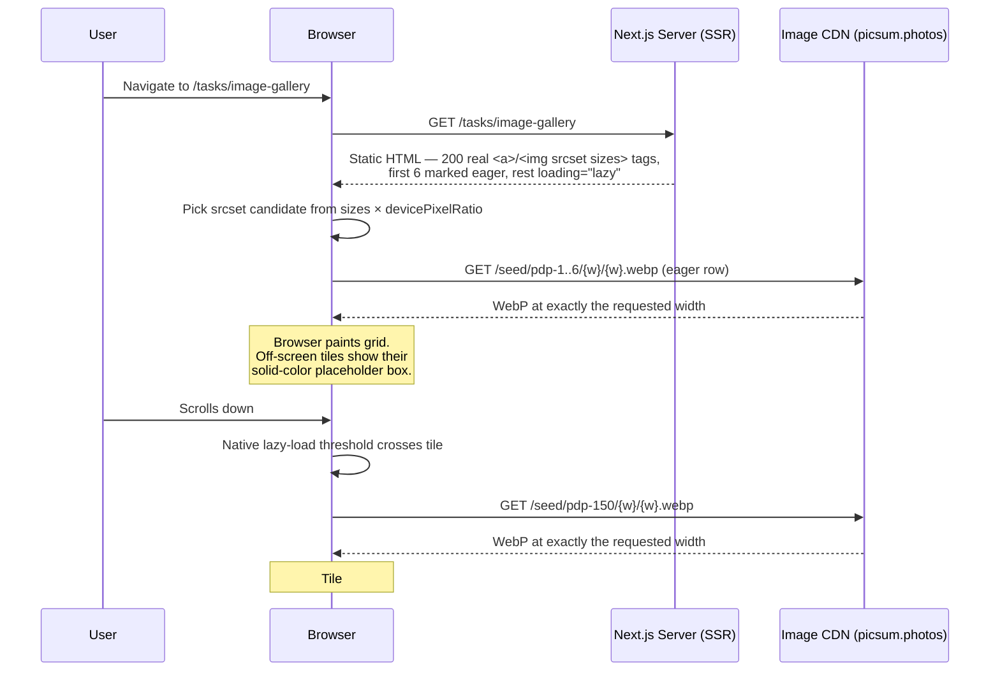
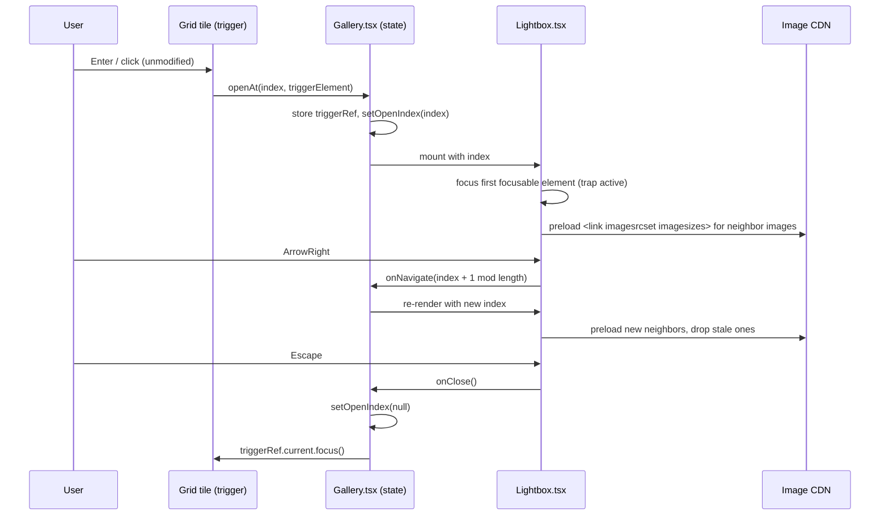
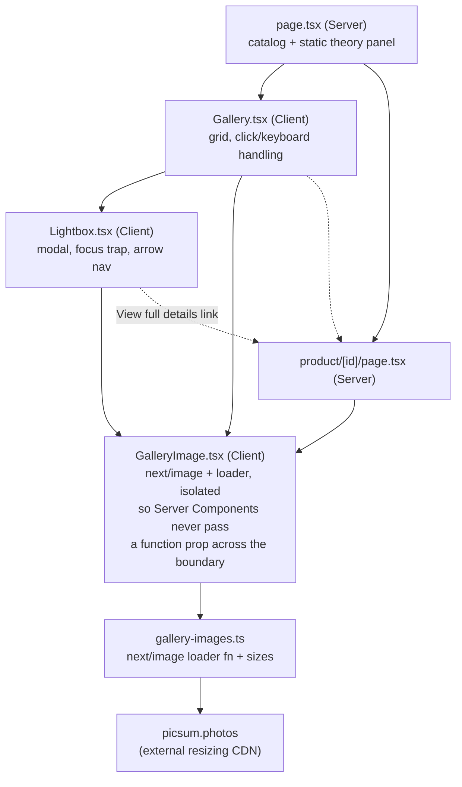

# DFA — Image Gallery with Lazy Loading

**Task:** [PoC] Image Gallery with Lazy Loading · Junior · Develop
**Template:** [coaxsoft.github.io/coax_dfa](https://coaxsoft.github.io/coax_dfa/)
**PoC location:** `src/app/tasks/image-gallery/`
**Tests:** `e2e/gallery.spec.ts` (9 tests, all passing against a production build)

---

## 📝 1. Feature Description

### 1.1 Why?

Product listing pages are the highest-traffic, most SEO-load-bearing pages
on a storefront — they're the pages search engines index and the pages a
slow or janky experience bounces users from before they ever reach a
product. A gallery that ships every image eagerly, shifts layout as photos
pop in, or hides its content behind client-side JavaScript directly damages
Core Web Vitals (LCP, CLS), search ranking, and conversion — three things
the business measures.

### 1.2 Goal

Ship a gallery pattern for the product listing page that:

- Loads fast on first visit and stays smooth scrolling through ~200 images.
- Never wastes bandwidth on images the user hasn't scrolled to.
- Never shifts layout as images arrive (CLS = 0 by construction, not by luck).
- Is fully keyboard-operable, including a lightbox preview with correct
  focus management.
- Renders as real, crawlable content before any JavaScript runs, so SEO
  and no-JS visitors are unaffected by the enhancement layer on top.

### 1.3 Challenges / Risks

- **Native lazy-loading isn't connection-aware.** `loading="lazy"` uses a
  fixed browser-internal threshold; it doesn't tighten automatically for a
  metered/`save-data` connection. Documented as an accepted gap for this
  PoC (see the 3G scenario below), not silently ignored.
- **Focus-trap correctness is easy to get subtly wrong** (e.g. trapping
  focus that was never inside the dialog to begin with, or losing the
  return-focus target across a re-render). Mitigated by capturing the
  trigger element in a `ref` at open time rather than re-deriving it at
  close time, and by an e2e test that Tabs through the dialog repeatedly
  and asserts focus never escapes it.
- **SSR/hydration drift.** If the client re-render ever produced different
  markup than the server did (e.g. gating the grid behind `useEffect`),
  the no-JS/SEO guarantee would silently break. Mitigated by having the
  Server Component own all content and the Client Component only add
  interactivity on top of markup that already exists.
- **Third-party image CDN.** Photos come from Lorem Picsum
  (`picsum.photos`), a free CDN that resizes on the fly
  (`/seed/{seed}/{w}/{h}.webp`). It stands in for Cloudinary/imgix/CloudFront
  in production. It answers each request with a `302` to its edge host
  (`fastly.picsum.photos`), so the network tab shows two entries per image;
  a production CDN would serve the bytes directly. The e2e suite intercepts
  these requests so tests never depend on a third-party service being up.

---

## ⚙️ 2. Non-Functional Requirements

| Category | Requirement | How this design meets it |
|---|---|---|
| **Performance** | Bounded network cost regardless of catalog size; good LCP; zero CLS | Native lazy loading for all but the first row (§ Actions); `priority`+`fetchpriority=high` on the first 6 tiles; `aspect-square` boxes reserve layout before any image byte arrives |
| **Security** | No injectable content in image URLs | Image URLs are built only from a numeric product id and a width from Next's configured size list. No user-supplied string ever reaches `src`/`srcset` |
| **Scalability** | Grid must not degrade as the catalog grows (200 → thousands) | DOM cost is currently O(n) in catalog size (all 200 tiles are rendered, just not all *fetched*) — acceptable at this scale, but not chosen blindly: virtualization (windowing the DOM to a constant node count) is the explicit subject of the Flight & Hotel Search task instead, at a scale where it earns its complexity |
| **Maintainability** | One place to change breakpoints/sizes/CDN behavior | `lib/gallery-images.ts` is the only place the CDN loader and the per-layout `sizes` strings live; swapping CDNs means changing one loader function |
| **Reliability** | Feature degrades gracefully, never breaks, if JS fails | Every tile is a real link in the initial HTML; the lightbox is additive, not load-bearing, for reaching a product |
| **Usability / a11y** | Full keyboard operability; correct focus management | Arrow-key roving focus across the grid, Enter/Space opens the lightbox, focus trap while open, focus returns to the trigger on close — all covered by e2e tests |

---

## ➡️ 3. Sequence Diagrams

**Initial load → lazy fetch as the user scrolls:**

**Lightbox open → keyboard navigation → close:**

---

## ✨ 4. Actions

Technical breakdown of every unit of work in this PoC:

- **`lib/gallery-data.ts`** — deterministic 200-item mock catalog (id,
  title, price), no `Math.random()` so SSR and client output match
  and tests are reproducible.
- **`lib/gallery-images.ts`**: the CDN contract.
  - `galleryImageLoader`: a `next/image` custom loader mapping
    `{src: productId, width}` → `https://picsum.photos/seed/pdp-{id}/{w}/{w}.webp`.
    The CDN does the resizing, so Next's built-in optimizer is bypassed and
    no `remotePatterns` entry is needed.
  - Three `sizes` strings (grid tile, lightbox, product page), each derived
    from that layout's real CSS (container width, padding, gaps, column count).
- **`app/tasks/image-gallery/GalleryImage.tsx`**: a thin Client Component
  wrapping `next/image` (`fill`, `sizes`, the loader). It exists because a
  Server Component can't pass a function (the loader) as a prop to a Client
  Component, so the loader import stays on the client side of the boundary.
  - Above-the-fold images use `loading="eager"` + `fetchPriority="high"`.
    In Next 16, `priority` is deprecated, and the docs recommend these props
    over `preload` when several images could be the LCP element.
  - On resize, the browser re-runs srcset selection. It downloads a bigger
    candidate when a tile grows (fewer columns can mean bigger tiles: 6 → 2
    columns takes a tile from 174px to ~270px). It never downloads a smaller
    one when a tile shrinks, because the larger file it already has looks
    fine scaled down.
  - The badge listens to the native `load` event. `next/image`'s `onLoad`
    fires only once per `img.src`, and only `currentSrc` changes on a swap.
    The picked width is also mirrored into `data-loaded-width` on the
    ``, so the swap is visible in the Elements panel.
  - A small badge shows the width the browser actually picked, read from
    `currentSrc`. `naturalWidth` can't be used for this because it's
    density-corrected for `w`-descriptor sources.
- The global `images` config (`deviceSizes`/`imageSizes`) is left at its
  defaults, so other `next/image` usages in the app are unaffected. The
  srcset therefore uses Next's default widths (128…3840w).
- **`app/tasks/image-gallery/page.tsx`** — Server Component; owns the
  catalog data and the static theory/objections panel; renders `Gallery`.
- **`app/tasks/image-gallery/Gallery.tsx`** — Client Component; the grid,
  per-tile click/keyboard handling (open lightbox on plain click/Enter,
  let modified clicks and keyboard grid navigation through), roving
  Arrow-key focus across rows/columns.
- **`app/tasks/image-gallery/Lightbox.tsx`** — Client Component; modal
  dialog, focus trap, Arrow-key browsing with wraparound, neighbor
  preloading via injected `<link rel="preload">`, focus-return on close.
- **`app/tasks/image-gallery/product/[id]/page.tsx`** — Server Component;
  the real destination every tile's `<a href>` points to, so the grid and
  the lightbox both terminate at the same indexable URL.
- **`e2e/gallery.spec.ts`** — Playwright suite (see § Test Coverage).

---

## 🏗️ 5. C4 Diagrams

**Context & Container levels: intentionally skipped.** This feature adds
no new deployable service. The only external dependency is a public image
CDN that the browser calls directly (no server-side integration). The existing Context/Container diagram for the app
as a whole (client browser ↔ single Next.js app) is unchanged by this work.

**Component level:**

**Code level:** not produced — the component boundaries above are the
useful level of detail for a PoC this size; a code-level diagram of two
~150-line React components would restate the source rather than add
insight.

---

## 🗄️ 6. Database Structure

**Not applicable.** This feature has no persistent backend data — the
product catalog is a deterministic, in-memory array (`lib/gallery-data.ts`)
generated for the PoC. No tables, columns, or migrations are introduced or
touched.

If this were wired to a real catalog, the read path would be a query
against whatever product/search index already backs the storefront (no new
schema implied by *this* feature — the gallery only needs `id`, a display
title, price, and an image reference, all of which a product table already
has).

---

## 🔗 7. API Documentation

### New endpoints

None. The app adds no API routes. Images are requested by the browser
straight from the external CDN:

| Part | Example | Notes |
|---|---|---|
| URL | `https://picsum.photos/seed/pdp-47/480/480.webp` | `seed` is stable per product, so every width is the same photo |
| Width | `32 … 3840` | next/image's default `imageSizes` + `deviceSizes`, so CDN cache keys stay bounded |
| Markup | `srcset="…/32/32.webp 32w, …, …/3840/3840.webp 3840w"` | Generated by `next/image` from the custom loader, paired with a layout-accurate `sizes` |

What each device requests (verified in Chromium against a production build):

| Viewport | DPR | Columns | Tile (CSS px) | Requested |
|---|---|---|---|---|
| 1440px desktop | 1× | 6 | 174 | `256w` |
| 1440px desktop (Retina) | 2× | 6 | 174 | `384w` |
| 800px tablet | 1× | 4 | 179 | `256w` |
| 390px phone | 3× | 2 | 165 | `640w` |

### Changed / deleted endpoints

**Deleted:** `GET /api/gallery-cdn/:id`, the mock SVG resizer from the first
iteration, now replaced by real photos from the CDN above.

## ✅ 8. Test Coverage Requirements

All coverage is new (no existing tests touched or reduced). Playwright
end-to-end suite, `e2e/gallery.spec.ts`, 9/9 passing against a production
build (`npm run test:e2e`):

| Requirement from the brief | Test |
|---|---|
| An image at position 150 is not fetched on initial load | `an image at position 150 is not fetched on initial load, and loads once scrolled to` |
| Scrolling doesn't cause layout shift | `scrolling through the gallery causes no measurable layout shift` (asserts cumulative layout-shift score < 0.05) |
| Lightbox opens via keyboard, traps focus, returns focus on close | `opens via Enter, traps focus, and returns focus to the trigger on Escape` |
| Lightbox Arrow-key navigation | `ArrowRight navigates to the next image and updates the counter` |
| Modified clicks still allow native "open in new tab" | `clicking a tile with cmd/ctrl held does not open the lightbox` |
| SEO/no-JS: real links exist without JS | `tiles are real links to product pages in the server-rendered HTML` (fetched via the HTTP API directly, not a browser) |
| Markup expresses responsive sizes | `server-rendered  carries the full srcset and a grid-aware sizes` |
| Each device requests a different image size | `a phone requests a different width than a desktop for the same tile` (desktop 1× → `256w`, phone 3× → a larger candidate) |
| Resizing re-selects the candidate when a tile grows | `narrowing past a breakpoint enlarges tiles, fetches a bigger candidate, and the badge follows` (1440px@2× → `384w`; 600px, 2 columns → `640w`; the badge and `data-loaded-width` on the `` update) |

**Explicitly not covered, and why:** the 3G-specific data-savings claim
(§ Challenges/Risks) is architectural, not testable via Playwright without
throttled network emulation against the live CDN. The suite stubs CDN
responses with a 1×1 PNG so it stays offline-safe and deterministic, so it
asserts *which* URLs/widths are requested, not how many bytes they weigh.
