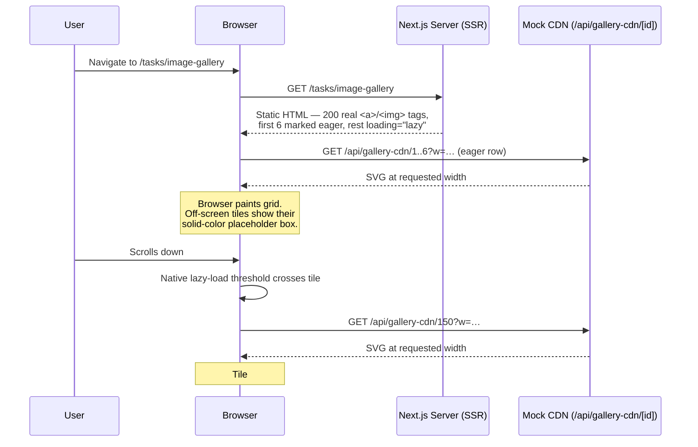
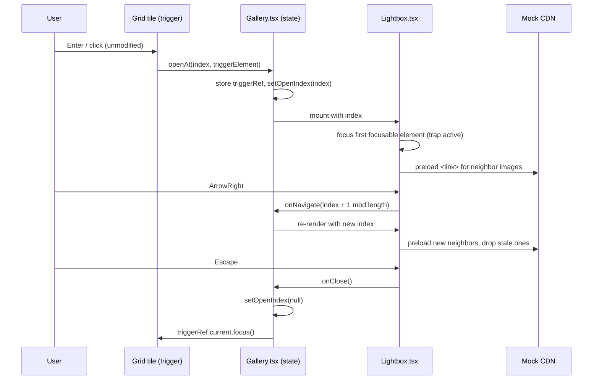
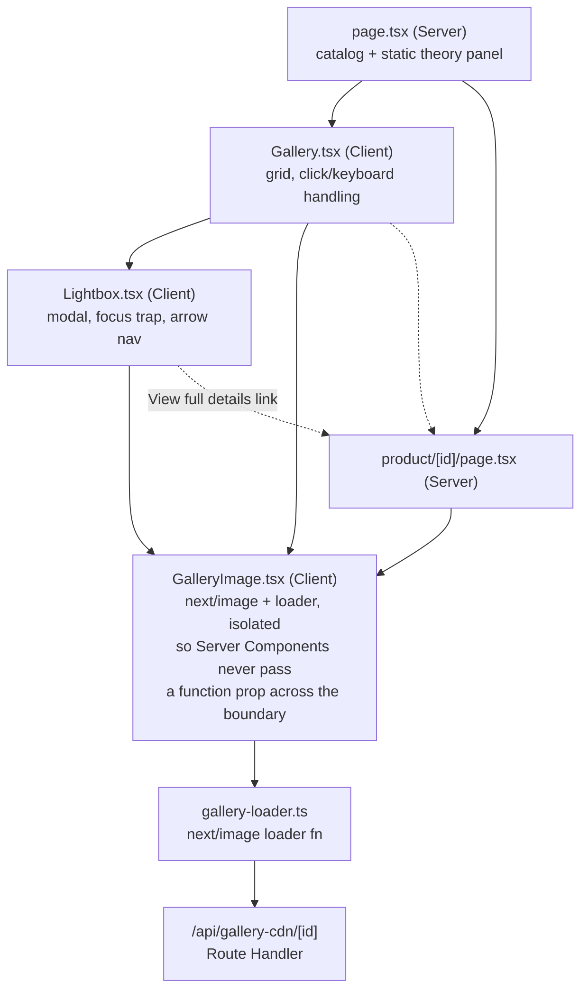

# DFA — Image Gallery with Lazy Loading

**Task:** [PoC] Image Gallery with Lazy Loading · Junior · Develop
**Template:** [coaxsoft.github.io/coax_dfa](https://coaxsoft.github.io/coax_dfa/)
**PoC location:** `src/app/tasks/image-gallery/`
**Tests:** `e2e/gallery.spec.ts` (9 tests, all passing against a production build)

---

## 📝 1. Feature Description

### 1.1 Why?

Product listing pages are the highest-traffic, most SEO-load-bearing pages
on a storefront — they're the pages search engines index and the pages a
slow or janky experience bounces users from before they ever reach a
product. A gallery that ships every image eagerly, shifts layout as photos
pop in, or hides its content behind client-side JavaScript directly damages
Core Web Vitals (LCP, CLS), search ranking, and conversion — three things
the business measures.

### 1.2 Goal

Ship a gallery pattern for the product listing page that:

- Loads fast on first visit and stays smooth scrolling through ~200 images.
- Never wastes bandwidth on images the user hasn't scrolled to.
- Never shifts layout as images arrive (CLS = 0 by construction, not by luck).
- Is fully keyboard-operable, including a lightbox preview with correct
  focus management.
- Renders as real, crawlable content before any JavaScript runs, so SEO
  and no-JS visitors are unaffected by the enhancement layer on top.

### 1.3 Challenges / Risks

- **Native lazy-loading isn't connection-aware.** `loading="lazy"` uses a
  fixed browser-internal threshold; it doesn't tighten automatically for a
  metered/`save-data` connection. Documented as an accepted gap for this
  PoC (see the 3G scenario below), not silently ignored.
- **Focus-trap correctness is easy to get subtly wrong** (e.g. trapping
  focus that was never inside the dialog to begin with, or losing the
  return-focus target across a re-render). Mitigated by capturing the
  trigger element in a `ref` at open time rather than re-deriving it at
  close time, and by an e2e test that Tabs through the dialog repeatedly
  and asserts focus never escapes it.
- **SSR/hydration drift.** If the client re-render ever produced different
  markup than the server did (e.g. gating the grid behind `useEffect`),
  the no-JS/SEO guarantee would silently break. Mitigated by having the
  Server Component own all content and the Client Component only add
  interactivity on top of markup that already exists.
- **The mock CDN doesn't model real image weight or latency.** It proves
  the `srcset`/lazy-loading *mechanics* (right URL requested at the right
  time, at the right width) but not real-world byte savings or 3G timing —
  called out explicitly rather than implied by the PoC's snappiness.

---

## ⚙️ 2. Non-Functional Requirements

| Category | Requirement | How this design meets it |
|---|---|---|
| **Performance** | Bounded network cost regardless of catalog size; good LCP; zero CLS | Native lazy loading for all but the first row (§ Actions); `priority`+`fetchpriority=high` on the first 6 tiles; `aspect-square` boxes reserve layout before any image byte arrives |
| **Security** | No injectable content in generated assets | The mock CDN route renders `id`/`width` values it already validated (numeric, clamped) into SVG text — no user-supplied string is ever reflected unescaped |
| **Scalability** | Grid must not degrade as the catalog grows (200 → thousands) | DOM cost is currently O(n) in catalog size (all 200 tiles are rendered, just not all *fetched*) — acceptable at this scale, but not chosen blindly: virtualization (windowing the DOM to a constant node count) is the explicit subject of the Flight & Hotel Search task instead, at a scale where it earns its complexity |
| **Maintainability** | One place to change breakpoints/sizes/CDN behavior | A single `sizes` string and a single `galleryImageLoader` function are the only two places breakpoint/CDN logic lives; both are colocated with the component that uses them |
| **Reliability** | Feature degrades gracefully, never breaks, if JS fails | Every tile is a real link in the initial HTML; the lightbox is additive, not load-bearing, for reaching a product |
| **Usability / a11y** | Full keyboard operability; correct focus management | Arrow-key roving focus across the grid, Enter/Space opens the lightbox, focus trap while open, focus returns to the trigger on close — all covered by e2e tests |

---

## ➡️ 3. Sequence Diagrams

**Initial load → lazy fetch as the user scrolls:**

**Lightbox open → keyboard navigation → close:**

---

## ✨ 4. Actions

Technical breakdown of every unit of work in this PoC:

- **`lib/gallery-data.ts`** — deterministic 200-item mock catalog (id,
  title, price, hue), no `Math.random()` so SSR and client output match
  and tests are reproducible.
- **`lib/gallery-loader.ts`** — `next/image` custom loader mapping
  `{src, width}` → `/api/gallery-cdn/{src}?w={width}`.
- **`app/tasks/image-gallery/GalleryImage.tsx`** — thin Client Component
  wrapping `next/image` with the loader applied internally. Exists because
  a Server Component cannot pass a function (the loader) as a prop to a
  Client Component — passing it directly from `product/[id]/page.tsx`
  threw `Functions cannot be passed directly to Client Components` at
  runtime until this wrapper isolated the loader import behind a
  component boundary that never receives it as a prop.
- **`app/api/gallery-cdn/[id]/route.ts`** — mock resizing CDN: validates
  the id exists, clamps requested width to `[32, 1600]`, returns a
  generated SVG with `Cache-Control: public, max-age=31536000, immutable`.
- **`app/tasks/image-gallery/page.tsx`** — Server Component; owns the
  catalog data and the static theory/objections panel; renders `Gallery`.
- **`app/tasks/image-gallery/Gallery.tsx`** — Client Component; the grid,
  per-tile click/keyboard handling (open lightbox on plain click/Enter,
  let modified clicks and keyboard grid navigation through), roving
  Arrow-key focus across rows/columns.
- **`app/tasks/image-gallery/Lightbox.tsx`** — Client Component; modal
  dialog, focus trap, Arrow-key browsing with wraparound, neighbor
  preloading via injected `<link rel="preload">`, focus-return on close.
- **`app/tasks/image-gallery/product/[id]/page.tsx`** — Server Component;
  the real destination every tile's `<a href>` points to, so the grid and
  the lightbox both terminate at the same indexable URL.
- **`e2e/gallery.spec.ts`** — Playwright suite (see § Test Coverage).

---

## 🏗️ 5. C4 Diagrams

**Context & Container levels: intentionally skipped.** This feature adds
no new external system, deployable service, or network boundary — the
"CDN" is a Route Handler running in the same Next.js process as everything
else in this repo, and the existing Context/Container diagram for the app
as a whole (client browser ↔ single Next.js app) is unchanged by this work.

**Component level:**

**Code level:** not produced — the component boundaries above are the
useful level of detail for a PoC this size; a code-level diagram of two
~150-line React components would restate the source rather than add
insight.

---

## 🗄️ 6. Database Structure

**Not applicable.** This feature has no persistent backend data — the
product catalog is a deterministic, in-memory array (`lib/gallery-data.ts`)
generated for the PoC. No tables, columns, or migrations are introduced or
touched.

If this were wired to a real catalog, the read path would be a query
against whatever product/search index already backs the storefront (no new
schema implied by *this* feature — the gallery only needs `id`, a display
title, price, and an image reference, all of which a product table already
has).

---

## 🔗 7. API Documentation

### New endpoint

**`GET /api/gallery-cdn/:id`**

Stands in for a real image CDN's on-the-fly resize endpoint.

| Param | Location | Type | Notes |
|---|---|---|---|
| `id` | path | number | Must match an existing product id |
| `w` | query | number | Requested width in px; clamped to `[32, 1600]`; defaults to 400 |

| Status | Body | When |
|---|---|---|
| `200` | `image/svg+xml` | Valid id — returns a `w`×`w` SVG placeholder |
| `404` | `{"error": "Unknown image id."}` | `id` doesn't exist in the catalog |

Response headers include `Cache-Control: public, max-age=31536000,
immutable`, matching how a real CDN asset would be cached.

### Changed / deleted endpoints

None — this feature only adds the endpoint above and two page routes
(`/tasks/image-gallery`, `/tasks/image-gallery/product/[id]`), neither of
which is an API contract consumed by another feature.

---

## ✅ 8. Test Coverage Requirements

All coverage is new (no existing tests touched or reduced). Playwright
end-to-end suite, `e2e/gallery.spec.ts`, 9/9 passing against a production
build (`npm run test:e2e`):

| Requirement from the brief | Test |
|---|---|
| An image at position 150 is not fetched on initial load | `an image at position 150 is not fetched on initial load, and loads once scrolled to` |
| Scrolling doesn't cause layout shift | `scrolling through the gallery causes no measurable layout shift` (asserts cumulative layout-shift score < 0.05) |
| Lightbox opens via keyboard, traps focus, returns focus on close | `opens via Enter, traps focus, and returns focus to the trigger on Escape` |
| Lightbox Arrow-key navigation | `ArrowRight navigates to the next image and updates the counter` |
| Modified clicks still allow native "open in new tab" | `clicking a tile with cmd/ctrl held does not open the lightbox` |
| SEO/no-JS: real links exist without JS | `tiles are real links to product pages in the server-rendered HTML` (fetched via the HTTP API directly, not a browser) |
| **Endpoint coverage** — the one new API route | `returns a correctly-sized SVG…`, `clamps out-of-range widths…`, `404s for an unknown product id` |

**Explicitly not covered, and why:** the 3G-specific data-savings claim
(§ Challenges/Risks) is architectural, not testable via Playwright without
a real image backend to measure bytes against — asserting on synthetic SVG
byte counts would test the mock, not the pattern.
