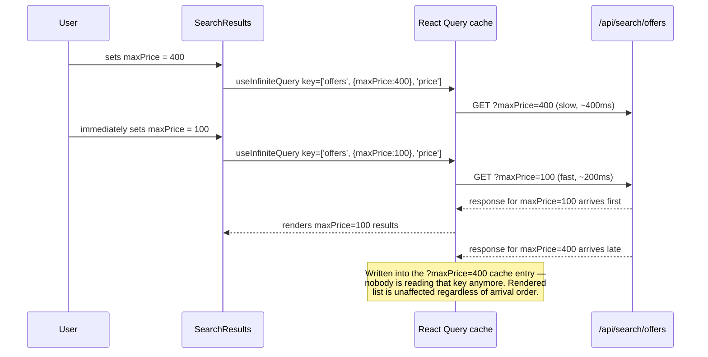
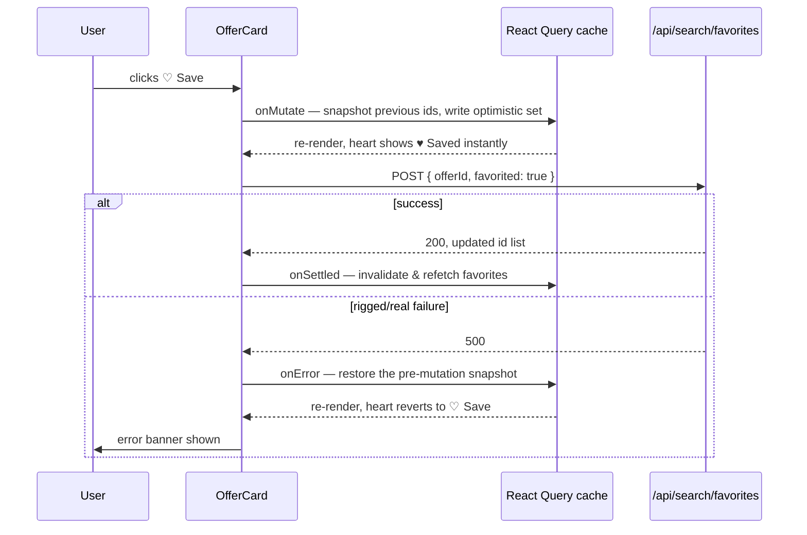
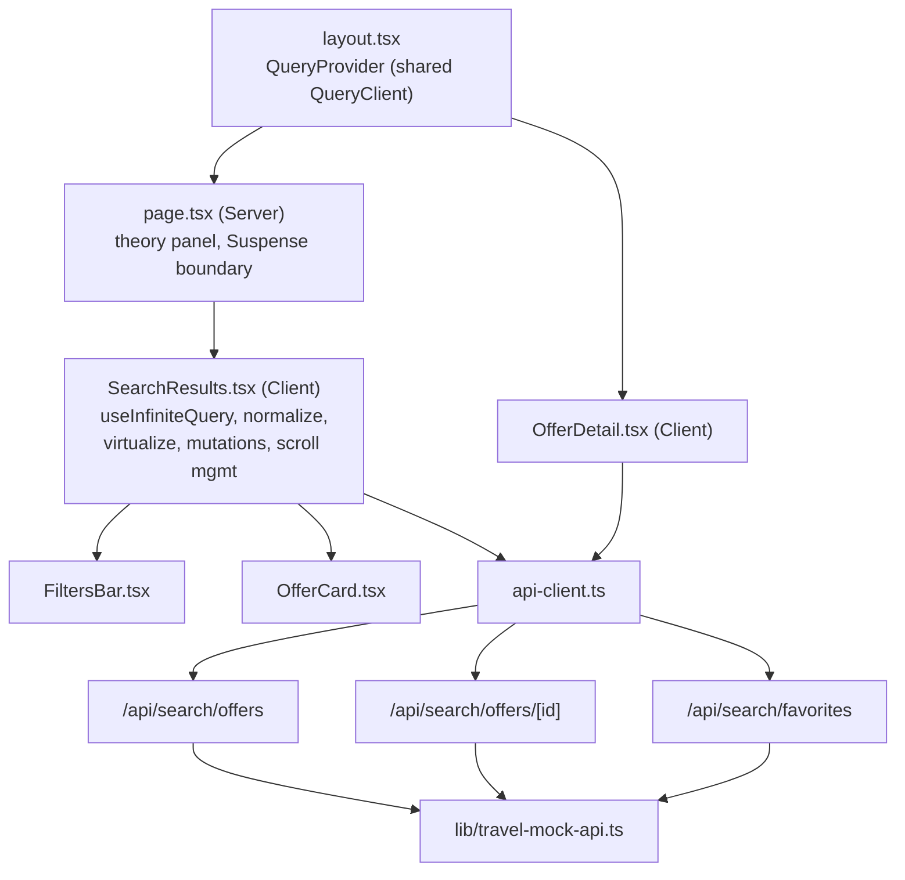

# DFA — Flight & Hotel Search Results with Infinite Scroll

**Task:** [PoC] Flight & Hotel Search Results with Infinite Scroll · Middle · Develop
**Template:** [coaxsoft.github.io/coax_dfa](https://coaxsoft.github.io/coax_dfa/)
**PoC location:** `src/app/tasks/search-infinite-scroll/`
**Tests:** `e2e/search.spec.ts` (8 tests, all passing against a production build)

> **Scope note:** the brief covers both flights and hotels. This PoC implements hotels only —
> the architecture (normalized store, cursor pagination, server-side filtering, optimistic
> favorites, virtualization) is entirely domain-agnostic; a flight result would reuse every
> layer below and only need its own card component and offer shape. Building both would
> duplicate the PoC's teaching point without adding architectural insight.

---

## 📝 1. Feature Description

### 1.1 Why?

Search results are the highest-friction page on a travel booking flow: travelers compare
dozens of options across long sessions, and every extra second of jank, every silently stale
price, and every lost scroll position after checking a detail page is a reason to bounce to a
competitor. This page's job is to stay fast and trustworthy at a scale (hundreds to thousands
of offers) where naive approaches — load everything, store the raw API response, refetch on
every back-navigation — visibly fall apart.

### 1.2 Goal

- Infinite-scroll through the full result set without the DOM growing unbounded.
- Filter/sort server-side so response size never depends on how many offers exist, only on
  page size.
- Never show a result set that doesn't match the currently-applied filters, even when filter
  changes race against slow in-flight requests.
- Favorite an offer with instant feedback that correctly reverts (with notice) on failure.
- Resume exactly where the traveler left off — scroll position and loaded pages — after
  viewing an offer's detail page and returning.
- Tell the traveler honestly when a price they're looking at might no longer be accurate.

### 1.3 Challenges / Risks

Real bugs surfaced while building this PoC, not hypothetical ones — worth recording in detail,
including a wrong turn along the way, because they're the actual argument for why this
architecture needs care, not just "use a library and it's handled":

- **Reading a ref during render.** The window virtualizer needs the results container's
  offset from the top of the document (`scrollMargin`). Reading `listRef.current.offsetTop`
  directly in the render body is invalid — refs are for effects/handlers, not render output —
  and React's stricter ref-access lint rule catches it. Fixed by measuring it in an effect and
  holding it in state instead.
- **The browser's own scroll restoration races a client-rendered list.** Left on `auto`
  (the default), the browser attempts to restore scroll on back-navigation before this page's
  cached data has re-rendered enough content to scroll that far — the resulting native
  `scroll` event was overwriting our own correctly-saved position with a premature, clamped
  one. Fixed by setting `history.scrollRestoration = 'manual'` and handling it entirely
  ourselves.
- **Restoring by raw pixel value is fundamentally the wrong approach for a virtualized list —
  not just under-tuned.** This took several iterations to diagnose correctly, and the first few
  fixes treated the symptom as a *timing* problem when it was actually a *strategy* problem:
  1. A single `scrollTo` landed off by a reproducible ~200px — blamed on Next's post-navigation
     scroll handling running after ours. Fixed by deferring to the next animation frame.
  2. Still occasionally wrong under real conditions — throttling CPU 4x and adding artificial
     API latency reproduced it reliably, because the virtualizer's *estimated* row heights take
     longer than one frame to settle into *measured* ones on slower hardware. Fixed by
     re-asserting the target every frame until the document's total height stopped changing,
     rather than for one fixed-duration window.
  3. **Still wrong** — a specific, reproducible case (clicking an offer that required scrolling
     past the first page to reach) consistently showed a *different offer* at the restored
     position after returning. The root cause: total document height staying stable does not
     mean the pixel-to-content mapping is stable. Rows *above* the saved position can be
     re-measured to different real heights than their 176px estimate while the *total* height
     stays put (some rows taller, others shorter, net unchanged) — silently shifting what
     content sits at "pixel 21272" even though the height-stability check saw nothing wrong and
     the pixel value itself was reproduced exactly.

  The actual fix: stop restoring by pixel entirely. Save *which item* (its virtual index, plus
  the pixel offset into that specific item) was at the top of the viewport, and restore with
  `virtualizer.scrollToIndex(index, { align: 'start' })` instead of `window.scrollTo`. This
  targets the same *content* regardless of how measurements above it have shifted — the
  virtualizer computes the correct pixel for that index using its current best-known
  measurements every time it's called, so calling it repeatedly (same reassert-until-stable
  loop, now watching `window.scrollY` itself for stability rather than document height)
  self-corrects toward the right position for the right item, not just *a* stable pixel.
  Re-verified against the exact scenario that broke pixel-based restoration, 8 times across
  dev mode (React Strict Mode active) and a production build: the correct offer is now at the
  correct position every time. A `wheel`/`touchmove` listener still cancels the reassertion
  immediately if the traveler starts scrolling manually, so it never fights real input.
- **Calling `scrollToIndex` in a tight per-frame loop collides with `@tanstack/react-virtual`'s
  own internal `flushSync`.** The reassert loop above calls `scrollToIndex` up to 60 times a
  second for a few seconds. By default the library synchronously force-renders
  (`useFlushSync: true`) on every scroll-driven update it observes, including ones the loop
  itself triggers — and calling `flushSync` that often, from a rapid-fire `requestAnimationFrame`
  loop, hit React's "flushSync was called from inside a lifecycle method" guard and visibly
  showed up as the scroll position jumping instead of settling smoothly, not just as a console
  warning. Fixed with `useFlushSync: false` on the virtualizer — a normal batched re-render is
  exactly as correct here and doesn't fight React's own scheduling. Re-verified across 5
  dev-mode runs of the same scenario: zero console errors, and the scroll trace settles to a
  single stable value within two frames instead of jumping. A console-error assertion was added
  to the scroll-restoration e2e test specifically because none of the prior tests would have
  caught this class of bug — a wrong pixel or a missing/duplicate network request are easy to
  assert on, a library silently warning (or worse, silently dropping a forced render) into the
  browser console is not, unless something is actually watching for it.
- **`scrollMargin` was double-counted when *saving* the position, landing consistently a few
  items further down the list on restore.** The index-based fix above eliminated the "different
  offer at the same pixel" bug, but manual testing then surfaced a smaller, very consistent
  residual: restoring always landed a handful of items past where the traveler actually was.
  Reading `virtual-core`'s source (`runningStart = paddingStart + scrollMargin`) confirmed why:
  `item.start` on every virtual item already has `scrollMargin` baked into it — which is exactly
  why the render code subtracts `scrollMargin` back out when positioning each row's CSS
  transform (`virtualRow.start - virtualizer.options.scrollMargin`). The save handler, written
  before that was traced through carefully, computed `window.scrollY + scrollMargin` to find
  "which item is at the top" — adding `scrollMargin` a second time on top of a value that
  already included it. That inflated target matched an item further into the list than the one
  actually at the viewport top, by roughly `scrollMargin`'s worth of rows — measured directly at
  ~516px in this layout, almost exactly three 176px cards, which is precisely "a few items down."
  Fixed by comparing directly against `window.scrollY` (already in the same absolute coordinate
  space as `item.start`) instead of adding `scrollMargin` again. Re-verified with a diagnostic
  that tracks a specific offer's index before and after the round trip: the shift is now exactly
  `0` across 5 consecutive runs, where it had consistently been off by several rows before.
- **A live `scroll` listener is the wrong way to capture "where the user was."** Saving
  scroll position continuously on every `scroll` event also captures the transitional scroll
  jumps that happen *during* a route change (the outgoing page's layout shifting as the new
  one mounts alongside it) — corrupting the saved value before the component even unmounts.
  Fixed by saving explicitly, once, at the moment the user clicks a link away from the list.
- **`staleTime: 0` (React Query's default) quietly defeats "no re-fetch."** Cached data
  renders instantly on remount either way, but a background revalidation request still fires
  immediately after — invisible to the user, but not actually zero network traffic. Set a
  60s `staleTime` so a search result set genuinely isn't re-requested just because the
  traveler glanced at a detail page and came back seconds later.
- **A 60s `staleTime` still isn't "never refetch."** A real traveler routinely reads a detail
  page for longer than 60 seconds — a length of time no quick round-trip test happens to
  exercise unless deliberately simulated (verified here with Playwright's clock API rather
  than a real 2-minute wait). Past that window, React Query's default `refetchOnMount: true`
  silently refetches the already-cached pages on return — wasted network traffic for data
  whose staleness this app already surfaces explicitly, per offer, via the price badge and
  refresh action. (An earlier version of this note claimed the refetch could also *reorder*
  the list, reasoning that the mock backend's price drift could shift an offer's price and the
  default sort is by price — that turned out to be wrong on closer reading of
  `travel-mock-api.ts`: `sortValue()` sorts on the stable, undrifted `pricePerNight`, never the
  time-varying displayed price, so a refetch can't actually reorder anything. Leaving this
  correction in rather than quietly fixing the claim, since misdiagnosing "why" a fix matters
  is its own kind of bug.) Fixed with `refetchOnMount: false` on this query specifically (not
  globally — the favorites and single-offer-detail queries should still revalidate on mount),
  justified by efficiency and consistency with the explicit-staleness design, not by a
  reordering risk that doesn't exist.
- **The in-page "Back to results" control was a plain `Link` to a bare URL, silently dropping
  applied filters.** Every scroll-restoration test in this file uses `page.goBack()` — the
  actual browser back button — which is exactly what hid this: it replays the previous history
  entry verbatim, query string included, so it never exercised the in-page button rendered on
  the detail page itself. That button was `<Link href="/tasks/search-infinite-scroll">` with no
  query string at all, so clicking it (as opposed to pressing the browser's own back button)
  silently reset any applied filters and lost the scroll-restoration state that depends on
  returning to the same history entry. Fixed by replacing it with a button that calls
  `router.back()` instead of pushing a fresh URL — the same semantics as the browser's own
  button, including correctly re-triggering the scroll-restoration logic, which is built around
  real back/popstate navigation rather than a forward push. A dedicated test now exercises the
  in-page button specifically, since none of the others would have caught this.

---

## ⚙️ 2. Non-Functional Requirements

| Category | Requirement | How this design meets it |
|---|---|---|
| **Performance** | DOM size and network cost must not scale with total offers (600 today, could be 5,000+) | `@tanstack/react-virtual`'s window virtualizer keeps mounted rows bounded regardless of how many pages have loaded (verified: <40 DOM nodes after loading 200+ offers); server-side filtering means the response is always one page, never the full matching set |
| **Correctness under race conditions** | A filter change must never let a stale in-flight response land on top of newer results | Each distinct `(filters, sortKey)` combination is its own React Query cache entry — a slow response for old filters has no currently-rendered key to write into, so it structurally cannot appear |
| **Consistency** | The list must never silently reorder or drop items above the scroll position | Pages are only ever appended, never re-sorted client-side; a filter/sort change always opens a fresh query key and resets to the top rather than mutating the current view |
| **Reliability** | A failed write must be visibly reverted, not silently swallowed or left inconsistent | Optimistic favorite mutation with `onError` rollback to the pre-mutation cache snapshot, plus a visible error banner — tested against a backend endpoint rigged to always fail |
| **Honesty / trust** | Traveler must never be shown a stale price as if it were current without being told | Per-offer `priceCheckedAt` timestamp drives a staleness badge and refresh action, independent per row |
| **Maintainability** | Mutating one offer (favorite, price refresh) shouldn't require finding it inside a nested page-array structure | Normalized `entities` dict + separate `resultOrder` id list, derived once via `useMemo` from the query cache |

---

## ➡️ 3. Sequence Diagrams

**Filter change racing an in-flight request:**

**Optimistic favorite with rollback:**

---

## ✨ 4. Actions

- **`lib/travel-types.ts`** — shared domain types (`HotelOffer`, `OfferWithMeta`,
  `SearchFilters`, `SortKey`), plus the demo-scaled constants (`PRICE_STALE_AFTER_MS`,
  `FORCE_FAVORITE_FAILURE_ID`).
- **`lib/travel-mock-api.ts`** — 600-item deterministic dataset; filter/sort/cursor-paginate
  logic; deterministic time-bucketed price drift (`getCurrentPrice`) so the same offer
  honestly reports a different "current" price on a later request without a live-mutating
  database; in-memory favorites store.
- **`app/api/search/offers/route.ts`** — `GET`, cursor-paginated list endpoint.
- **`app/api/search/offers/[id]/route.ts`** — `GET`, single-offer price refresh.
- **`app/api/search/favorites/route.ts`** — `GET`/`POST`, favorites list + toggle (with the
  one fixed always-fails id).
- **`app/tasks/search-infinite-scroll/layout.tsx` + `QueryProvider.tsx`** — the QueryClient
  lives in the route segment's layout (not the page), so it survives client-side navigation
  to the offer detail page and back — this is what makes "no re-fetch on back" possible at
  all, not just the caching itself.
- **`api-client.ts`** — typed `fetch` wrappers, including passing the `AbortSignal` through
  to `fetch` for the offers query.
- **`FiltersBar.tsx`** — server-side filter/sort controls; every change writes to the URL via
  `router.replace` (no local filter state — the URL is the single source of truth).
- **`OfferCard.tsx`** — one row; renders the normalized entity, computes staleness from a
  shared `now` clock passed down from the parent (one interval, not one per row).
- **`SearchResults.tsx`** — composition root (144 lines: JSX plus the wiring between hooks);
  the actual logic lives in `hooks/`, split by concern once the component grew past the point
  of being readable as one piece: `useSearchFilters` (URL ⇄ filters/sort), `useOffersList`
  (`useInfiniteQuery`, normalization into `{ entities, resultOrder }`, price-refresh mutation),
  `useFavorites` (optimistic toggle + rollback), `useResultsVirtualizer` (`scrollMargin`
  measurement, the virtualizer instance, the ref-without-a-dependency pattern needed to call it
  from effects safely), and `useScrollRestoration` (see § Challenges/Risks for what that one
  actually took). The one thing deliberately *not* extracted is the infinite-scroll trigger
  effect — it only wires two hooks' outputs together and holds no state of its own, so a hook
  for it would be indirection without a matching cohesive concern behind it.
- **`offer/[id]/page.tsx` + `OfferDetail.tsx`** — detail page; compares the price the
  traveler saw in the list (`?listPrice=`) against the freshly-fetched current price and
  flags a change.
- **`BackToResultsButton.tsx`** — shared client component calling `router.back()` rather than
  linking to a bare URL, so returning preserves applied filters and correctly re-triggers
  scroll restoration (see § Challenges/Risks).
- **`e2e/search.spec.ts`** — Playwright suite (see § Test Coverage).

---

## 🏗️ 5. C4 Diagrams

**Context & Container: skipped**, for the same reason as the image gallery task — no new
external system or deployable service; the "backend" is Route Handlers in this same Next.js
process.

**Component level:**

**Code level:** not produced, same rationale as the image gallery DFA — the component
boundaries above are the useful grain for a PoC of this size.

---

## 🗄️ 6. Database Structure

**Not applicable.** The catalog is a deterministic in-memory array
(`lib/travel-mock-api.ts`), and favorites are an in-memory `Set`. No schema is introduced.

If this were wired to a real backend, the natural shape would be: an `offers` table/index
supporting the filter predicates used here (price, rating, amenities, refundable) with a
compound index matching the sort key for genuine keyset pagination, and a `favorites` join
table (`user_id`, `offer_id`, `created_at`) — the API contract below (cursor, filters, sort)
would not need to change at all; only what's behind `searchOffers()` would.

---

## 🔗 7. API Documentation

### New endpoints

**`GET /api/search/offers`**

| Param | Type | Notes |
|---|---|---|
| `cursor` | string (base64url) | Opaque; encodes the last-seen sort value + id. Omit for the first page. |
| `limit` | number | Default 20, max 50 |
| `maxPrice` | number | Optional ceiling |
| `minRating` | number | Optional floor |
| `refundableOnly` | `'true'` | Optional |
| `amenities` | comma-separated | AND semantics — offer must have all listed |
| `sortKey` | `price` \| `rating` \| `duration` | Default `price` |

Response: `{ items: OfferWithMeta[], nextCursor: string | null, totalCount: number }`.

**`GET /api/search/offers/:id`** — recomputes and returns one offer's current price
(`{ item: OfferWithMeta }`), 404 if unknown.

**`GET /api/search/favorites`** — `{ favoriteIds: string[] }`.

**`POST /api/search/favorites`** — body `{ offerId, favorited }`; returns the updated
`{ favoriteIds }`, or `500` if `offerId` is the one fixed always-fails id (see § Challenges).

### Changed / deleted endpoints

None.

---

## ✅ 8. Test Coverage Requirements

All coverage is new. Playwright suite `e2e/search.spec.ts`, 7/7 passing against a production
build (`npm run test:e2e`):

| Requirement from the brief | Test |
|---|---|
| **Situation 1** — filter change with in-flight requests produces a correct, non-stale result set | `a filter change while a request is in flight produces a result set matching the latest filter, not a stale one` — fires two filter changes back-to-back without awaiting the first, then asserts every rendered price respects only the final filter |
| **Situation 2** — scroll restoration after viewing a detail page and returning, with no refetch | `navigating to an offer detail page and back shows the same offer at the same position, without refetching` — asserts the *same offer* is back at the same virtual index (not just an approximate pixel — see §1.3 for why pixel-exactness isn't actually the right invariant), that scroll lands in the same neighborhood, and that no request after returning either repeats an already-seen URL or omits its cursor (i.e., no page-1 restart); `returning after longer than the query staleTime does not silently refetch and reorder the list` — the same content-identity guarantee specifically after the point where React Query's default would otherwise trigger a background refetch (simulated via Playwright's clock API, not a real 2-minute wait); `the in-page "Back to results" button preserves applied filters, not just the browser back button` — the same return-state guarantee via the in-page control, not only the browser's own back button |
| **Situation 5** — DOM node count stays bounded as the list grows | `mounted DOM node count stays bounded after loading 200+ offers` — scrolls past 10+ pages (200+ offers) and asserts fewer than 40 mounted cards throughout |
| Optimistic favorite applies and persists | `a normal favorite toggle applies optimistically and persists` |
| Optimistic favorite reverts on failure, with notice | `a failed favorite toggle reverts and notifies the traveler` — against the endpoint's one deterministically-rigged offer id |
| Price-refresh mechanism returns current data | `each offer card shows its own priced-as-of timestamp implicitly via a working refresh action once stale` |

**Explicitly not covered, and why:** the 20-second `PRICE_STALE_AFTER_MS` UI badge itself isn't
exercised end-to-end with a real wait (that would make the suite slow and, on a loaded CI
runner, flaky against the threshold); instead, the endpoint it depends on is tested directly,
and the threshold constant is a single, obviously-named value if it ever needs adjusting.
Situations 3 (list price vs. detail price vs. booking price) and 4 (combined-filter query
shape at 5,000 offers) are addressed architecturally in §1.3 and §7 rather than with a test,
since both describe a data-scale/business scenario rather than a specific interaction this
PoC's fixed 600-row dataset can meaningfully simulate.
